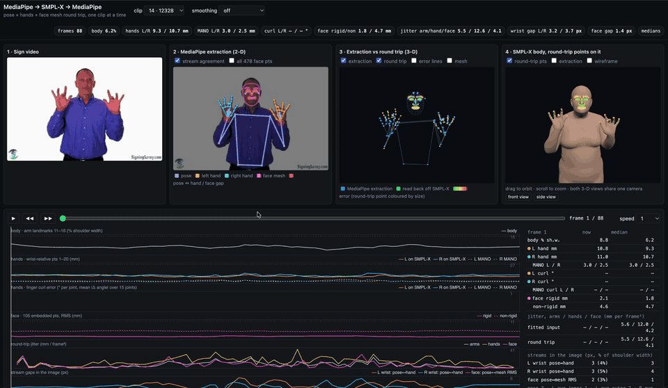

# KineticAugment: A Geometry-Aware Augmentation Framework for Human Motion

<p align="center">
  
</p>

**KineticAugment** is a production-ready framework for augmenting human motion data while preserving anatomical and semantic plausibility. It's designed for researchers and engineers working on Sign Language Recognition, Human Activity Recognition, and other motion analysis tasks who need to increase dataset size without introducing unrealistic or label-altering artifacts.

Traditional data augmentation techniques often fail on skeletal time-series data, creating impossible poses and unnatural movements. KineticAugment solves this by treating the human body as a structured kinematic system, governed by a set of core biomechanical and contextual principles.

---

## Key Features

*   **Anatomically Plausible:** Augmentations respect joint limits, bone lengths, and self-collision constraints via SMPL-X body model integration.
*   **Kinematically Consistent:** Transformations correctly propagate through the body's kinematic chains using forward kinematics.
*   **Temporally Coherent:** Generates smooth motion that respects human dynamics, with velocity limiting and jerk analysis.
*   **Semantically Aware:** A priority system prevents augmentations from changing the fundamental meaning of a motion.
*   **Dual-Mode Processing:** Fast landmark-based (extrinsic) or accurate SMPL-X parameter-space (intrinsic) augmentations.
*   **Physics-Based Constraints:** PyBullet integration for self-collision detection and resolution.
*   **Comprehensive Evaluation:** Built-in metrics for quality, smoothness, diversity, and constraint satisfaction.
*   **Task-Specific Profiles:** Easily configure the augmentation pipeline using YAML configuration files.

## Seeing the augmentations: the round-trip demo

<p align="center">
  <a href="docs/media/round_trip_demo.mp4">
    
  </a>
  <br>
  <em>Screen recording of the round-trip viewer (preview; <a href="docs/media/round_trip_demo.mp4">full 42 s recording</a>).</em>
</p>

This is how we check augmentations visually. Augmentations are not applied to the raw landmarks.
Each frame's MediaPipe pose, hand and face landmarks are fitted to one SMPL-X body (MANO hands,
head and jaw). The augmentation edits that body, and MediaPipe-format landmarks are read back off
the mesh. If the round trip with no augmentation reproduces the original signing, then the
differences seen after an augmentation come from the augmentation itself.

The viewer shows, for one clip at a time:

1. **Sign video**: the source clip.
2. **MediaPipe extraction (2-D)**: pose, hand and face-mesh landmarks drawn on the frame.
3. **Extraction vs round trip (3-D)**: the extracted landmarks against those read back off SMPL-X,
   coloured by error.
4. **SMPL-X body**: the fitted body with the round-trip points on it, which you can drag to orbit.

Below the panels, per-frame plots track the body, hand, finger-curl and face errors, the jitter,
and the gaps between streams. Those plots are what show whether a clip can be augmented safely.
To run it yourself, see [Round-Trip Viewer](#round-trip-viewer) below.

## Augmentation ranges

The week-4 profiles set every range about 25% beyond the widest range the literature supports, so the augmentation is deliberately more varied than what has been proven. The proven range is recorded next to each used one below, and in the YAML comments. See [Augmentation ranges](./docs/Augmentation_Ranges.md) for the 25% rule, the sources and per-row notes.

| Augmentation | Proven range (source) | Used in week-4 profiles |
|---|---|---|
| View yaw | ±20° (Spoken2Sign **[M7]**) | ±25° |
| View pitch | ±5° ("a few degrees" **[T]**) | ±6° |
| Mirror | p = 0.5 **[M6]**; cost 1.3 pp on WLASL once **[T]** | p = 0.5 (a probability, not widened) |
| Uniform duration | 0.67–1.5×; 0.5× hurt once **[L6.2, M6, M3, T]** | 0.6–1.65×, log-uniform |
| Arm joints: shoulder, wrist | ±4° at p = 0.3 (SPOTER **[M1]**) | ±5° |
| Arm joints: elbow | ±7.5°, no harm in pose-based translation **[T]** | ±9.5° |
| Whole-scene scale | 0.8–1.2 (GISLR **[M10]**) | 0.75–1.25 |
| Uncentre | ±0.1 of the frame (GISLR **[M10]**) | ±0.125, hands still kept in the frame |
| Limb length | no literature; between-signer spread 5.7% in this project's MediaPipe data (Grounding §6.1) | ±7% |
| Movement size | no measured range; 0.85–1.15 is Grounding's linguistic example **[L2.10, L2.11]** | 0.8–1.2, log-uniform |
| Location jitter | σ = 10 mm, truncated at 20 mm (production spread **[T]**) | σ = 12.5 mm, truncated at 25 mm |
| Joint coupled noise, arms | as arm joints above **[M1, T]** | shoulder/wrist σ = 2.5°, truncated at 5°; elbow σ = 4.75°, truncated at 9.5° |
| Joint coupled noise, fingers | no published range | σ = 3.75°, truncated at 7.5° (estimate 3° / 6°, widened) |
| Handshape jitter | no published range; GISLR "finger-tree rotate" gives no angle **[T]** | non-selected and thumb σ = 7.5°; selected σ = 3.75°; selected flexion σ = 2°; all truncated at 2σ |
| Expression jitter | no published range; lexical mouth patterns excluded **[L7.3, L1.5]** | brows and eyes σ = 0.0625, truncated at 0.125; cheeks/nose σ = 0.0375, truncated at 0.075; mouth/jaw off |
| Varied time warp | none: non-uniform warps are excluded **[L6.3, L6.4]** | knot rates 0.7–1.43×, log-uniform |
| Segment time warp | none: excluded as above | window 20–60% of the clip, factor 0.6–1.65× |
| Frame dropping | ≥ 10 fps, where human intelligibility stops improving **[T]**; masked runs ≤ 8 frames **[M4, M10]** | ≥ 8 fps; max gap 125 ms; p = 0–0.2; target 12–25 fps |
| Hand-dropout runs | runs ≤ 8 frames **[M4, M10]**; start rate none, measured 0.039 per detected interior hand-frame (`scripts/measure_hand_dropout.py`) | runs of 1–10 frames; start rate 0–0.05 |

`configs/slr_week4_default.yaml` turns on the scene augmentations, uniform duration, joint coupled noise on the arms and the fingers, and random frame dropping; everything else is present but off. To run a profile, load it with `load_profile` and pass each clip to `AugmentationChain(profile, skeleton).run(clip)`. Set the clip's camera first with `clip.replace(camera=scene.fit_clip_camera(clip, hands, skeleton, frames=result.frames))`: without it, uncentre is skipped (fallback `no_camera`) and the image-space outputs are `None`.

## Documentation

*   **[Research onboarding guide](./docs/research-guide/index.md)**: Source walkthroughs, geometry, data/training, evidence-based status and a newcomer learning plan.

The complete documentation provides the theory, architecture, and practical guides for using the framework.

*   **[00 - Introduction](./docs/00_Introduction.md)**: Why KineticAugment? The problem with naive augmentation.
*   **[01 - Core Principles](./docs/01_Core_Principles.md)**: A deep dive into the 6 pillars that govern the framework.
*   **[02 - Framework Architecture](./docs/02_Framework_Architecture.md)**: The layered model: Core Engine, Constraint System, and Task Profiles.
*   **[03 - The Augmentation Catalogue](./docs/03_Augmentation_Catalogue.md)**: A comprehensive list of available augmentation techniques.
*   **[04 - Task-Specific Profiles](./docs/04_Task_Specific_Profiles.md)**: How to tailor augmentations for your specific application.
*   **[05 - The Validation Framework](./docs/05_Validation_Framework.md)**: Ensuring the quality and validity of generated data.
*   **[Glossary](./docs/GLOSSARY.md)**: Definitions of key terms.

## Installation

```bash
# Clone the repository
git clone https://github.com/yourusername/KineticAugment.git
cd KineticAugment

# Create conda environment
conda create -n kinetic python=3.10
conda activate kinetic

# Install dependencies
pip install -e .

# Download SMPL-X models (required for intrinsic augmentations)
# Place in models/smplx/ directory
```

## Quick Start

### Basic Usage with Presets

```python
from kinetic_augment import Pipeline

# Create pipeline with built-in preset
pipeline = Pipeline.from_preset('moderate')  # Options: none, conservative, moderate, aggressive

# Augment motion data (numpy array of shape [frames, landmarks, 3])
augmented_motion = pipeline.process(landmarks)
```

### Using YAML Configuration

```python
from kinetic_augment import Pipeline

# Load from YAML config file
pipeline = Pipeline.from_yaml('configs/slr_profile.yaml')

# Process with constraint enforcement
augmented = pipeline.process(landmarks, enforce_constraints=True)
```

### PyTorch Dataset Integration

```python
from kinetic_augment import Pipeline, AugmentedLandmarkDataset
from torch.utils.data import DataLoader

# Create pipeline and dataset
pipeline = Pipeline.from_preset('moderate')
dataset = AugmentedLandmarkDataset(
    data_source=landmarks_list,  # List of numpy arrays
    labels=labels,               # List of integer labels
    pipeline=pipeline,
    mode='train',
    num_augmented_versions=3,    # 3x dataset expansion
)

# Use with PyTorch DataLoader
loader = DataLoader(dataset, batch_size=32, shuffle=True)
```

### Evaluating Augmentation Quality

```python
from kinetic_augment.evaluation import MetricAggregator
from kinetic_augment.evaluation.metrics import (
    SmoothnessMetric,
    VarianceMetric,
    LimbLengthConsistencyMetric,
)

# Create metric aggregator
aggregator = MetricAggregator([
    SmoothnessMetric(),
    VarianceMetric(),
    LimbLengthConsistencyMetric(),
])

# Evaluate augmented samples
results = aggregator.evaluate(augmented_samples)
for name, result in results.items():
    print(f"{name}: {result.value:.4f}")
```

### Running Benchmark Experiments

```python
from kinetic_augment.evaluation.benchmark import (
    BenchmarkRunner,
    PRESET_COMPARISON,
    BenchmarkReport,
)

# Run comparison of all presets
runner = BenchmarkRunner(
    experiments=PRESET_COMPARISON,
    output_dir='results/benchmark',
)
results = runner.run(run_training=False)  # Quality metrics only

# Generate report
report = BenchmarkReport(results)
report.save('results/', formats=['txt', 'csv', 'md'])
```

## Project Structure

```
KineticAugment/
├── src/kinetic_augment/
│   ├── body_model/          # SMPL-X integration & joint mapping
│   ├── augmentations/       # Extrinsic, intrinsic, temporal transforms
│   ├── constraints/         # Joint limits, velocity, collision detection
│   ├── pipeline/            # Unified pipeline & PyTorch datasets
│   └── evaluation/          # Metrics, datasets, models, benchmarks
├── configs/                 # YAML configuration files
├── scripts/                 # Test and utility scripts
├── docs/                    # Documentation
└── models/                  # SMPL-X models (not in git)
```

## Round-Trip Viewer

`demo/round_trip/` is an interactive web page, in two pages:

- **Round trip** (`index.html`): checks the MediaPipe → SMPL-X → MediaPipe round trip (pose, hands
  and face mesh) clip by clip, with optional landmark smoothing.
- **Augmentations** (`augment.html`): shows a clip's Tier 1 augmentations as the original, the
  original and augmented bodies one over the other, and the augmented body, with a note on what
  each augmentation changes.

To run it for one clip, from the repository root, after the one-time setup (install and model
files):

```bash
python scripts/export_round_trip_demo.py --clips 20983 --video-dir path/to/videos
```

```bash
python3 -m http.server 8765 --directory demo/round_trip
```

Then open <http://localhost:8765/#clip=20983> (round trip) or
<http://localhost:8765/augment.html#clip=20983&a=combined> (augmentations).
[demo/round_trip/README.md](demo/round_trip/README.md#quick-start-run-the-viewer-for-one-clip)
gives every step, the model files needed, how to check each step worked, and fixes for common
problems.

## Available Augmentations

| Category | Augmentations |
|----------|---------------|
| **Extrinsic** | GlobalRotation, GlobalScaling, GlobalTranslation, PoseFlipping, GaussianNoise, JointDropout |
| **Intrinsic** | JointAnglePerturbation, HandPosePerturbation, BodyShapeVariation |
| **Temporal** | TimeWarping, TemporalCrop, SpeedPerturbation, FrameDropout, TrajectoryJittering, MotionSmoothing |

## Evaluation Metrics

| Category | Metrics |
|----------|---------|
| **Quality** | LimbLengthConsistency, PoseValidity, AnatomicalPlausibility |
| **Temporal** | Velocity, Smoothness, TemporalCoherence, SpectralSmoothness |
| **Diversity** | Variance, DistributionShift, AugmentationDiversity, Coverage |
| **Constraints** | JointLimitCompliance, ViolationSeverity, ConstraintSatisfaction |

## Testing

```bash
# Run all phase tests
CUDA_VISIBLE_DEVICES="" python scripts/test_phase1.py  # SMPL-X integration
CUDA_VISIBLE_DEVICES="" python scripts/test_phase2.py  # Augmentations
CUDA_VISIBLE_DEVICES="" python scripts/test_phase3.py  # Collision detection
CUDA_VISIBLE_DEVICES="" python scripts/test_phase4.py  # Pipeline
CUDA_VISIBLE_DEVICES="" python scripts/test_phase5.py  # Evaluation
```

## Contributing

We welcome contributions from the community! Whether it's adding a new augmentation, improving documentation, or reporting a bug, your help is valued. Please read our **[Contributing Guide](./CONTRIBUTING.md)** to learn how you can get involved.

## License

This project is licensed under the [MIT License](./LICENSE).

## Citation

If you use KineticAugment in your research, please cite:

```bibtex
@software{kineticaugment2026,
  title = {KineticAugment: A Geometry-Aware Augmentation Framework for Human Motion},
  author = {Vangelis Metsis},
  year = {2026},
  url = {https://github.com/imics-lab/KineticAugment}
}
```
